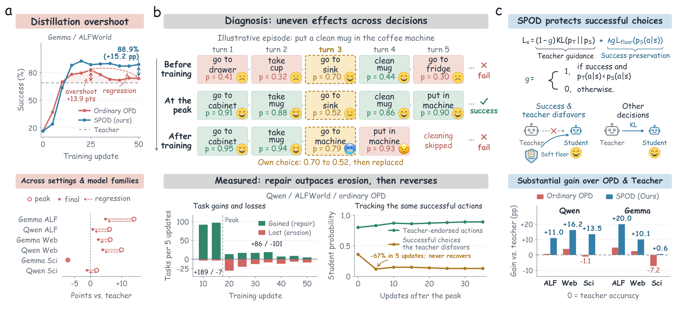

# Beyond the Teacher: Understanding and Preserving Distillation Overshoot in Agentic On-Policy Distillation

<p align="center">
  
</p>

## Overview

On-policy distillation (OPD) trains an agent on its own trajectories, with supervision from a stronger teacher. In
multi-turn agentic tasks we observe a counterintuitive pattern: a smaller, initially weaker student can substantially
outperform its teacher during training, only to regress as distillation continues. We call this **distillation
overshoot**.

Decision- and task-level analyses trace overshoot to two competing effects of OPD:

- **Repair:** the teacher fixes weak student decisions.
- **Erosion:** the teacher pulls the student away from its own successful choices that the teacher disfavors.

Early in training, repair outpaces erosion and the student surpasses the teacher. As training continues, erosion
overtakes repair and the gains vanish.

## Method

We propose a simple and effective intervention, **Success-Preserving On-Policy Distillation (SPOD)**. SPOD keeps the
teacher's guidance where it helps and protects the student's successful choices where it conflicts. It needs only
binary episode success and the model probabilities that OPD already computes.

For a sampled decision state $s$ with student action $a$ (a full action string, scored as a sequence):

$$
\mathcal{L}(s) = (1-g)\,\mathrm{KL}\big(p_T(\cdot\mid s)\,\|\,p_S(\cdot\mid s)\big) + g\,\mathcal{L}_{\text{floor}}(s),
\qquad
\mathcal{L}_{\text{floor}}(s) = \frac{1}{n}\max\big(0,\ \log\tau - \log p_S(a\mid s)\big)
$$

$$
g = \begin{cases} 1 & \text{if the episode succeeded and } p_T(a\mid s) < p_S(a\mid s) \\ 0 & \text{otherwise} \end{cases}
$$

where $n$ is the number of action tokens. On states of successful episodes where the forward-KL term would *lower*
the student's own action, SPOD drops the teacher term and applies a one-sided probability floor instead. Every other
state receives the ordinary full-vocabulary forward KL. All runs use $\tau = 0.5$.

The rule lives in the training loss of each pipeline:
[`spod/alfworld_qwen/train.py`](spod/alfworld_qwen/train.py#L79) (with
[`sgate.py`](spod/alfworld_qwen/sgate.py)), [`spod/alfworld_gemma/train.py`](spod/alfworld_gemma/train.py#L116) and
[`spod/webshop_scienceworld/train.py`](spod/webshop_scienceworld/train.py#L109).

## Main results

Final success rates (%). ALFWorld is reported per task family; WebShop and ScienceWorld overall; Overall averages the
three benchmarks. Subscripts give SPOD's gain over ordinary OPD. ∗ uses evaluation results to choose the checkpoint
(oracle).

| Method | Pick | Look | Clean | Heat | Cool | Pick2 | ALFWorld Avg | WebShop | ScienceWorld | Overall |
|---|---|---|---|---|---|---|---|---|---|---|
| ***Qwen3.5-2B ← Qwen3.5-27B*** | | | | | | | | | | |
| Teacher 0-Shot | 98.3 | 80.6 | 74.7 | 53.0 | 72.5 | 95.1 | 80.0 | 34.1 | 42.4 | 52.2 |
| Student 0-Shot | 18.6 | 55.9 | 0.0 | 0.0 | 0.0 | 11.4 | 11.6 | 7.9 | 6.1 | 8.5 |
| Ordinary OPD | 99.4 | 77.4 | 71.3 | 67.5 | 69.6 | 94.3 | 80.7 | 38.0 | 41.3 | 53.3 |
| best ckpt. (peak)∗ | 97.2 | 90.3 | 86.8 | 73.5 | 79.0 | 86.2 | 86.1 | 44.0 | 44.4 | 58.2 |
| stop at eval dip∗ | 97.2 | 90.3 | 86.8 | 73.5 | 79.0 | 86.2 | 86.1 | 44.0 | 44.4 | 58.2 |
| stop at train dip | 100.0 | 83.9 | 77.6 | 47.0 | 70.3 | 92.7 | 79.8 | 44.0 | 40.6 | 54.8 |
| retire at teacher level | 100.0 | 83.9 | 77.6 | 47.0 | 70.3 | 92.7 | 79.8 | 38.4 | 41.3 | 53.2 |
| TCOD | 100.0 | 87.1 | 66.0 | 65.8 | 57.9 | 90.2 | 77.9 | 40.1 | 37.8 | 51.9 |
| Guided-OPD | 98.8 | 83.8 | 71.2 | 66.6 | 63.7 | 87.8 | 79.2 | 37.2 | 41.3 | 52.6 |
| SAGE-OPD | 98.8 | 87.1 | 71.3 | 66.6 | 70.3 | 86.2 | 80.4 | 39.8 | 40.4 | 53.5 |
| **SPOD (ours)** | 99.4 | 86.0 | 89.7 | 77.8 | 90.6 | 97.6 | **91.0**<sub>+10.3</sub> | **50.3**<sub>+12.3</sub> | **55.9**<sub>+14.6</sub> | **65.7**<sub>+12.4</sub> |
| ***Gemma-4-E4B ← Gemma-4-31B*** | | | | | | | | | | |
| Teacher 0-Shot | 100.0 | 46.2 | 35.6 | 69.2 | 80.4 | 74.8 | 68.9 | 38.0 | 61.1 | 56.0 |
| Student 0-Shot | 45.2 | 20.4 | 5.7 | 2.6 | 6.5 | 12.2 | 16.5 | 27.3 | 22.6 | 22.1 |
| Ordinary OPD | 92.7 | 28.0 | 50.0 | 84.6 | 83.3 | 93.5 | 73.7 | 40.5 | 53.9 | 56.0 |
| best ckpt. (peak)∗ | 97.7 | 62.4 | 74.1 | 84.6 | 76.8 | 94.3 | 82.8 | 44.3 | 53.9 | 60.3 |
| stop at eval dip∗ | 97.7 | 62.4 | 74.1 | 84.6 | 76.8 | 94.3 | 82.8 | 44.3 | 48.9 | 58.7 |
| stop at train dip | 97.7 | 62.4 | 74.1 | 84.6 | 76.8 | 94.3 | 82.8 | 44.3 | 48.3 | 58.5 |
| retire at teacher level | 95.5 | 74.2 | 66.1 | 82.1 | 63.8 | 86.2 | 78.2 | 44.3 | 48.3 | 56.9 |
| TCOD | 97.7 | 32.2 | 37.3 | 70.9 | 73.9 | 74.8 | 66.3 | 41.4 | 48.7 | 52.1 |
| Guided-OPD | 100.0 | 21.5 | 83.9 | 87.1 | 77.5 | 47.1 | 74.2 | 36.0 | 54.8 | 55.0 |
| SAGE-OPD | 97.7 | 37.6 | 74.1 | 72.6 | 79.0 | 73.2 | 75.5 | 40.5 | 52.2 | 56.1 |
| **SPOD (ours)** | 100.0 | 57.0 | 92.5 | 87.2 | 86.2 | 96.7 | **88.9**<sub>+15.2</sub> | **48.1**<sub>+7.6</sub> | **61.7**<sub>+7.8</sub> | **66.2**<sub>+10.2</sub> |

## Repository structure

```
SPOD/
├── configs/                      # one config per model × benchmark (hyperparameters of the paper runs)
├── data/                         # exact train / evaluation task lists
├── scripts/
│   ├── launch.py                 # start one training run on two GPUs
│   └── setup_{alfworld,webshop,scienceworld}.sh
└── spod/
    ├── alfworld_qwen/            # Qwen3.5-2B ← Qwen3.5-27B on ALFWorld
    ├── alfworld_gemma/           # Gemma-4-E4B ← Gemma-4-31B on ALFWorld
    └── webshop_scienceworld/     # both model pairs on WebShop and ScienceWorld
```

Each pipeline runs three cooperating processes that exchange requests through files in the run directory: a vLLM
rollout worker for the student policy, a teacher scorer on the second GPU, and the trainer, which applies the SPOD loss
and evaluates every five updates.

## Setup

**Training environment** (Python 3.11, two GPUs per run):

```bash
pip install -r requirements.txt
```

**Environments.** Each benchmark simulator runs in its own interpreter, set through environment variables:

```bash
bash scripts/setup_alfworld.sh        # prints: export ALFWORLD_DATA=... ALFWORLD_PYTHON=...
bash scripts/setup_scienceworld.sh    # prints: export SCIENCEWORLD_PYTHON=...   (needs Java 11+)
conda create -n webshop python=3.8 -y && conda activate webshop
bash scripts/setup_webshop.sh         # prints: export WS_HOME=... WEBSHOP_PYTHON=...
```

**Models** are downloaded from the Hugging Face Hub at the revisions pinned in the configs (`Qwen/Qwen3.5-2B`,
`Qwen/Qwen3.5-27B`, `google/gemma-4-E4B-it`, `google/gemma-4-31B-it`). A local model directory can also be given in
place of a Hub id.

## Data

The benchmarks are interactive environments, so the data released here are the exact task lists used for training
and evaluation. The environments themselves come from their official sources through the setup scripts.

| Benchmark | Train | Evaluation | Source |
|---|---|---|---|
| ALFWorld | 3,553 games (`train_qwen.json` / `train_gemma.json`: same games, the order used by each pipeline) | `valid_seen` (140) + `valid_unseen` (134) | [ALFWorld](https://github.com/alfworld/alfworld) 0.4.2 |
| WebShop | 6,410 goals | 500 test goals | [WebShop](https://github.com/princeton-nlp/WebShop), 1,000-product set |
| ScienceWorld | 2,880 variations | 180 test variations (6 task families) | [ScienceWorld](https://github.com/allenai/ScienceWorld) 1.2.3 |

ALFWorld game paths are relative to `$ALFWORLD_DATA`.

## Training and evaluation

```bash
python scripts/launch.py configs/qwen_alfworld.json       --run-dir runs/qwen_alfworld
python scripts/launch.py configs/gemma_alfworld.json      --run-dir runs/gemma_alfworld
python scripts/launch.py configs/qwen_webshop.json        --run-dir runs/qwen_webshop
python scripts/launch.py configs/gemma_webshop.json       --run-dir runs/gemma_webshop
python scripts/launch.py configs/qwen_scienceworld.json   --run-dir runs/qwen_scienceworld
python scripts/launch.py configs/gemma_scienceworld.json  --run-dir runs/gemma_scienceworld
```

Use `--gpus 0,1` to choose the two GPUs (student, teacher). Training runs 50 updates on ALFWorld and WebShop and 40 on
ScienceWorld. Each update covers 72 tasks with up to eight sampled states per episode. The learning rate warms up over
three updates to 1e-5 and decays to 1e-6 with a cosine schedule.

Evaluation runs every five updates, with three sampling seeds over the full evaluation set. Results are written to the
run directory: `learning_curve.json` and `evaluation/` for WebShop, ScienceWorld and Gemma ALFWorld, and
`evaluation/tasks*_{seen,unseen}*.json` for Qwen ALFWorld. Reported numbers are final success, averaged over the three
evaluation seeds; ALFWorld is task-weighted over `valid_seen` and `valid_unseen`. Final BF16 weights are saved in the run
directory.

## License

MIT. See [LICENSE](LICENSE).
